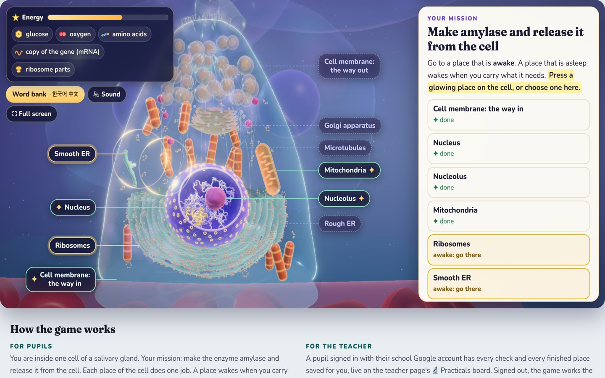

# Y7 Biology practical: cell structures and organelles

**Live:** <https://nlcsbiology.com/ks3-y7-cell-organelles/>

A game for Year 7: pupils go inside one cell of a salivary gland, drawn in 3D, and explore its organelles and structures.
Their mission is to make the enzyme **amylase** and release it from the cell. Each place in the cell does one job, so they
use every structure in turn, in the order the cell uses them. At the end they test their amylase on starch.

| Place | What the pupil does there | What they bring away |
|---|---|---|
| The cell you know | the five Year 7 parts lit alone; then everything an electron microscope shows; what an organelle is | the map |
| Cell membrane: the way in | sees the membrane drawn bigger, as two layers of lipids, with the inside of the cell above and the tissue fluid and a capillary below, where the red blood cells (7.5 µm across), discs thinner in the middle, flow in a capillary wide enough for them (8.5 µm); a red blood cell releases oxygen, which passes straight through the lipids; glucose and an amino acid each choose their way in (each passes through its own carrier protein, in the real order: it binds in the carrier's pocket, the carrier shuts behind it, then opens to the inside, and only then does it leave); carbon dioxide leaves into the plasma, the liquid part of the blood, between the red blood cells | glucose, oxygen, amino acids |
| Mitochondria | sees one mitochondrion whole, from outside, then presses ✂ Cut it open and its front half lifts away: its two membranes at their true thickness and the folds of the inner one (cristae); zooms in, with a scale bar, to its edge, where every lipid, its proteins (each seen whole, no lipid in front of it) and the molecules are drawn at their true sizes; splits glucose in the cytosol; sends the two smaller molecules into the matrix (through a channel protein, then a carrier protein, in the same real order) and six oxygen molecules (straight between the lipids); watches the smaller molecules broken down step by step into carbon dioxide and hydrogen, each named, then sees the carbon dioxide leave through both membranes (↺ Watch again plays it again); watches the chain of proteins pump hydrogen ions into the space inside the fold, where they build up behind the inner membrane like water behind a dam, then presses the oxygen, which joins hydrogen at the last protein: water; then watches them flow back only through ATP synthase, which turns like a watermill (the way it turns when it makes ATP), one step for each ion, and makes ATP | energy (the bar) |
| Nucleus | the first time, the nucleus is closed: the pupil dives into one nuclear pore at its true size (about 120 nm across, with a scale bar): its three rings of proteins, its filaments, the protein net in its middle (soft protein threads, which bend aside like doors) and its basket. The camera stops above the pore (the pore and its protein net are named), then moves slowly round and down to the side of the pore while the near half of the pore fades away like a lid: the pore is seen cut in half, and the outer membrane, the space between the membranes and the inner membrane are named, the outer membrane from above, the inner from below and the space by words written inside it, so that no name hides a membrane or the space (the cut shows each membrane as two layers of lipids, the two joined round the pore). The half comes back first, so that the nucleus is whole again; then the camera goes over the pore and down through its middle, slowly through its protein net, whose threads part just in front of it like doors, then quickly through the basket (its small ring made of proteins too) into the dark inside of the nucleus. In the dark the camera turns to face the nucleus upright; then a light spreads from the pore and shows the chromosomes and the nucleolus while the camera moves straight back, without turning, until the whole nucleus shows, its front removed, and it stays open (later visits go in as before); finds chromosome 1 and the amylase gene; copies it (mRNA) with one press, or, as an Explorer, watches a film of how a cell copies a gene (a zoom from a chromosome's packed fibre through the histones to the double helix, with scale bars of 30, 11 and 2 nm; the DNA untwisted as a ladder of nucleotides, and only then A, T, C and G; the bases pair, A with T and C with G, joined by hydrogen bonds drawn as dashes; the strands separate inside the enzyme, where the hydrogen bonds break, RNA building blocks pair with one strand one at a time, the copy grows above the DNA and leaves); chooses how the copy leaves, then sees it, from outside the nucleus, leave through a nuclear pore | the copy of the gene |
| Nucleolus | builds the two ribosome parts; sends each out through a pore | ribosome parts |
| Ribosomes | joins the parts on the copy; matches each amino acid to the code; chooses where this ribosome must work | the start of the chain |
| Rough ER | docks on a channel; makes the chain inside the rough ER; cuts the signal; folds it (the active site) | amylase in a vesicle |
| Smooth ER | a fine net of tubes at their true width (0.05 µm; this cell has little smooth ER); makes lipids; they form a membrane | lipids |
| Golgi apparatus | joins the stack; moves through it; sorts proteins by their labels; packages amylase | a packed vesicle |
| Microtubules | close up, everything at its true size (the microtubule 25 nm wide, the vesicle 900 nm across): the motor protein is probably dynein, its two heads rings 14 nm across, joined with dynactin (38 nm) and an adaptor protein on the vesicle (without them dynein is folded and almost never walks); Attach lands its heads on the microtubule, and it walks seven steps of different sizes (the vesicle moves most often 8 nm, once 16 nm, once back; one head steps round the microtubule and back); then, from far away, chooses the track to the top of the cell at each crossing | the vesicle at the top |
| Cell membrane: the way out | a nerve message (smelling bread); exocytosis into the duct | amylase in saliva |
| Does your amylase work? | starch and iodine solution: saliva in one well, water (the control) in the other | |

**A map, not a corridor.** Daniel: "not just one path. It can fork … but clearly you're gonna need something from one
place to then continue on the other place". Places sleep (grey, in mist) until the pupil carries what they need, and every
lock is a real dependency in the cell: the ribosome needs the copy of the gene, its two parts, amino acids and energy; the
rough ER cannot make a vesicle without lipids from the smooth ER; every job costs energy, so pupils return to the
mitochondria with more glucose and oxygen. Pupils choose the order at three points.

**Simple and real.** The game opens with the cell pupils know: the Year 7 diagram beside the 3D cell, with the same five
parts lit in both. Then it shows everything an electron microscope shows. Each place says whether its structure is an organelle (Daniel's definition: a membrane-bound structure
with a specific function), with its one definition from the shared KS3 glossary. **See the real thing** shows the Year 7
diagram or a detailed diagram, real electron micrographs, a real human cell in 3D (its organelles from an electron
microscope, the one in that place lit) and the real size. The world itself is a picture made for the game:
true shapes and places (the nucleus low in the cell, rough ER round it, the Golgi above, the vesicles at the top, by the duct),
magical colours and light, and molecules drawn far larger than life (the page says so), except at the mitochondria, the
microtubules and the nuclear pore, where every size is true and the camera zooms in instead
(Daniel: "as close to relative size as possible"); the smooth ER's tubes are drawn at their true width too. The mitochondria
of the world are real shapes: 33 mitochondria of one human cell, measured with an electron microscope (short ones, long
tubes and branched ones), each drawn with its two membranes.

**Checks.** After each place, two or three checks (32 in all): key words typed (a first letter, the word list or a hint
when stuck, counted as help on the teacher's board), choices with no give-away, sorting and ordering. Every word a check uses
is explained above it, and every key word can be tapped for its meaning, with Korean and Chinese.
**How to say the hard words.** Under a hard word's meaning, in the word bank and under each place's definition: its spelling
guide, and UK and US buttons that play the Cambridge Dictionary's recordings from Cambridge's own site, with its name, a
link to the word's page (Daniel: "the very complex words … to know how they pronounce", then "and us pronunciation too").
The music pauses while a word plays and goes on after it ("pause for a moment the running music and then relaunch it
after the word is done"). A word Cambridge has no page for keeps its guide only (cytosol, nucleolus, lysosome, Golgi).
A place is **done** (✦) only when its jobs are done **and** every one of its checks is right (Daniel: "It's like
completing a game. So you have to do the actions, but also complete the questions"); only then does what it gave wake the
next places, and the list of places says "answer its checks to finish" until then. Answers shown after two tries are put
in place, but the pupil still presses Check (it counts as help on the board).

**For IB students: From glucose to ATP.** When every check of the way in or of the mitochondria is right, an **IB
Biology** switch appears in that place (Daniel: "Don't provide the IB toggle until they have completed everything").
Switched on, each step says what IB adds, every sentence tagged *SL and HL*, *HL only* or *Beyond the IB guide* with the
statement of the IB Biology guide (2025); the place's sentences, choices and names on the picture use the IB terms instead
of the Year 7 ones (a phospholipid bilayer, not two layers of lipids; pyruvate, protons, the intermembrane space, the
glucose transporter and the amino acid transporter); the Year 7 checks fold away; and doors, like the place's end card,
open **From glucose to ATP**. That is a view of its own, over the whole page, with its own address for IB lessons:
<https://nlcsbiology.com/ks3-y7-cell-organelles/glucose-to-atp/>. It follows one glucose molecule from the blood into a
muscle cell and on to ATP, at true sizes, in seven chapters: the map; into the cell (the glucose transporter, and
hexokinase trapping glucose); glycolysis (its ten steps, each with its reason, and the lactate and yeast branches: above
the molecules, every enzyme at its true size in a row, named, with the one at work lit); into the mitochondrion (porin, the
pyruvate carrier); the link reaction; the Krebs cycle (above the molecules, a diagram of its order: each molecule with its
carbons, and each step's enzyme with what enters and leaves it); and the electron transport chain, the proton gradient as
a dam, and ATP synthase. Then the tally, two questions, and Daniel's article, which opens only when both
are answered. Every molecule is drawn atom by atom, glucose's carbon atoms numbered 1 to 6 and followed through every
reaction; every protein is its measured shape; side paths explore NAD, FAD, coenzyme A, oxidation and reduction, and the
two ways of making ATP. A longer side path, **Explore: insulin and its receptor** (IB HL, C2.1.11; its own address,
<https://nlcsbiology.com/ks3-y7-cell-organelles/glucose-to-atp/#x-insulin-1>), opens from chapter 1: insulin binds to its
receptor, a glycoprotein drawn in the membrane with its carbohydrate chains; the receptor changes from a V into an
upside-down T (both shapes measured); its two tyrosine kinase parts meet and phosphorylate tyrosines; one phosphorylation
atom by atom; the sequence of reactions (IRS-1, PI3-kinase, PIP3, Akt, AS160, Rab); a vesicle 60 nm across, cut open,
moves to the plasma membrane and fuses with it; its glucose transporters, now in the plasma membrane, let more glucose
in. Steps wait for Next; every key word opens its meaning, with Korean and Chinese.

**The final check.** At the end of the journey each pupil gets a code of their own (CELL- and four letters or numbers,
made from the email they signed in with, so a friend's code does not work). The ✦ Final check, last in the list of
places, opens with that code: 20 questions, 30 marks, about 15 minutes. Twelve have one right answer, four ask for every
right answer, two ask for the names of six numbered parts of a drawing of the cell, one puts in order what happens to a
new vesicle of amylase and one sorts structures into the nucleus or the cytoplasm. Every question is new (none shares a
run of six words with the game), and none gives another away. There is no help and nothing is marked until the pupil finishes; they have one go, and
then see their score and which questions were not right, never the answers. The right answers are not in the page,
only their scrambled fingerprints, so a pupil cannot read them out of it. A pupil must be signed in to start it; the
teacher's board then has every answer, the score and the time it took.

**Sound.** Off until the pupil presses 🔈 Sound (top left, from the first screen, with ⛶ Full screen; on a phone, as two
small icons): a chime at once, then, from the moment they dive into the 3D cell and never before, music for the
journey: three pieces by the film composer Scott Buckley, played in turn (Daniel: "more like a space journey … it needs
to make you goosebumps"); and soft sounds of real instruments when something happens.

**How the game works, for the pupils.** A new game opens on one card: their mission (make amylase and release it from
the cell) and how the game works, in six short lines with the key words highlighted, while the cell loads behind it; its
button starts the dive into the cell. **How to play**, at the top, shows it again (Daniel, 8 Nov 2026: "this is the first
thing that you should show … make it fun"). The notes for teachers are here, not on the page, and the page's foot keeps its
sources, credits and licences folded.

**For the teacher.** A pupil signed in with their school Google account has every check and every finished place saved for
their teacher, live on the teacher page's 🔬 Practicals board. Signed out, the game works the same and nothing leaves the
computer. Progress is kept in the browser, so a pupil can stop and carry on later.

**Made by** Dr Daniel Mompel Riera. Something wrong, or a suggestion? dmompelriera@nlcsjeju.kr

**Licence.** Code: AGPL-3.0 (`LICENSE`). Teaching material: CC BY-NC-SA 4.0 (`LICENSE-CONTENT`): free for teaching, not for
selling. Third-party pictures, music and sounds keep their own licences (below).

## Pictures and data from other people

| What | Source | Licence |
|---|---|---|
| the 3D cell | made for this page, after LadyofHats' *Animal cell structure* (Wikimedia Commons) | the page's own |
| the Year 7 diagram | domdomegg, *Simple diagram of animal cell*, Wikimedia Commons (ribosomes added by the Cells Lab) | CC BY 4.0 |
| the detailed diagram | LadyofHats (Mariana Ruiz), *Animal cell structure en.svg*, Wikimedia Commons; names, lines and flagellum taken off | public domain |
| the head with its salivary glands | Blausen Medical, *Medical gallery of Blausen Medical 2014*, WikiJournal of Medicine 1(2) | CC BY 3.0 |
| inside a salivary gland | made for this page, to scale (`tools/gland-svg.py`) | the page's own |
| one cell, for the final check's two label questions | made for this page (`tools/cell-svg.py`), in the game's colours | the page's own |
| electron micrographs | see `img/real/CREDITS.md` | CC BY 4.0 and public domain |
| the real cell in 3D | Janelia Research Campus, OpenOrganelle *jrc_hela-2* (Xu et al. 2021, *Nature* 599:147; Heinrich et al. 2021, *Nature* 599:141), made into a model by the Foundations hub | CC BY 4.0 |
| the shapes of the world's mitochondria | the same OpenOrganelle data (*jrc_hela-2*, the label of each mitochondrion): the centre line and radius of 33 of its 300 mitochondria (`tools/mito-shapes.py`) | CC BY 4.0 |
| ATP synthase, in the mitochondria and in From glucose to ATP | its measured shape: human ATP synthase by electron cryo-microscopy at 2.53 Å, PDB 8H9S (Lai et al. 2023, *Molecular Cell* 83:2137), each of its 27 subunits drawn as a smooth surface (`tools/atp-synthase.py`; the structure file stays on this computer) | CC0 (wwPDB) |
| the molecules of From glucose to ATP | their ideal shapes from the wwPDB Chemical Component Dictionary: 39 molecules, each at the charge it has in a cell (pH 7.2), its atoms named so that each reaction moves every atom to its place (`tools/ib-molecules.py`) | CC0 (wwPDB) |
| the proteins of From glucose to ATP | 23 measured structures from the Protein Data Bank, each drawn as a smooth surface (`tools/ib-proteins.py`; the structure files stay on this computer; each paper is named in `js/ib/prot/`): GLUT4 7WSM; the ten enzymes of glycolysis, hexokinase 2 2NZT, 1JLH, 4XYJ, 4ALD, 1HTI, 1U8F, 2XE7, 1YFK, 2PSN, 3SRF; lactate dehydrogenase 1I10; yeast pyruvate decarboxylase 1PVD and alcohol dehydrogenase 4W6Z; porin 2JK4; the pyruvate carrier in three shapes, 8YW6, 9KNX, 8YW9; the pyruvate dehydrogenase core 6CT0; complexes I, III and IV 5XTH; complex II 8GS8; cytochrome c 3ZCF; the ATP–ADP exchanger 1OKC | CC0 (wwPDB) |
| the insulin receptor, insulin and the receptor's kinase in From glucose to ATP | their measured shapes from the Protein Data Bank (`tools/ib-insulin.py`; the structure files stay on this computer): the receptor before insulin binds, PDB 8U4B (An et al. 2024, *Nature Communications* 15:7567), and with four insulin molecules bound, PDB 6PXV (Uchikawa et al. 2019, *eLife* 8:e48630), each of its domains moved from one shape to the other; its kinase part with ATP and a piece of IRS-1, PDB 1IR3 (Hubbard 1997, *EMBO Journal* 16:5572) | CC0 (wwPDB) |
| the music | Scott Buckley: 'The Distant Sun', 'Adrift Among Infinite Stars' and 'Penumbra', released under CC-BY 4.0, [www.scottbuckley.com.au](https://www.scottbuckley.com.au) (made smaller, each set to the same loudness: `tools/music.py`) | CC BY 4.0 |
| the game's sounds (bells, rubbed glasses, wind chimes, a harp note) | Versilian Community Sample Library (VCSL), Versilian Studios, [github.com/sgossner/VCSL](https://github.com/sgossner/VCSL) (`tools/sounds.py`, each note tuned) | CC0 |
| how to say the hard words | the Cambridge Dictionary's UK and US recordings, played from [dictionary.cambridge.org](https://dictionary.cambridge.org) (never stored here), its name beside each word with a link to the word's page; if Cambridge's will not play, a Wikimedia Commons recording where the word has one (`assets/say/CREDITS.md`, credited as it plays) | Cambridge's own; Commons: CC0, CC BY, CC BY-SA |
| three.js | the npm package three@0.185.1 (`js/vendor/three/VENDORED.txt`) | MIT |

Behind the scenes

The `tools/` named here stay on Daniel's computer: they are not in this repository.

- `index.html` is the page; `js/story.js` holds every word of every place and the board's parts and game squares (keep a
  question's or a game's id when rewording: it is its square on the teacher's board); `js/questions.js` every check;
  `js/words.js` which glossary words the word bank shows.
- `js/world/` draws the cell: `cellbuild.js` the structures (true positions, sizes in micrometres; one random seed, so the
  world is the same at every load), `magic.js` the materials and light, `world.js` the renderer, the camera's flights and
  what a pupil points at. `js/game/` is the game: `state.js` (what a pupil carries, which places are awake), `quest.js` (the
  panel and the buttons that stand on the parts), `play.js` (every step of every place), `names.js` (names on level lines, or above or below a thin part such as a membrane cut open, on an upright line,
  which follow their parts while the camera moves and are placed again, smoothly, when it stops), `intro.js` (the dive into the cell), `transcribe.js` (the Explorer film: how a cell copies a gene, a 3D view of its own), `simplecard.js` (the Year 7 diagram), `lens.js` and `real.js` (See the real thing), `final.js` (the final check: the code, the
  questions one at a time, marking at the end, the result). `js/world/pore.js` draws the nuclear pore of the dive at its true size (its rings, filaments, basket and the protein net of its channel, in a patch of the two membranes that fits the hole the dive opens in the world's envelope; every size and its source in its header), in two halves, so that the near half can be taken away and the pore seen in section; until a pupil has been inside, the nucleus is closed (`world.setNucleus`, from the saved game's `in-nucleus`). `js/world/mitoparts.js` draws the mitochondria: the world's
  real shapes (from `mito-shapes.js`, written by `python3 tools/mito-shapes.py` from the OpenOrganelle data already on this
  computer, never downloaded), the one you visit cut open (its cut face worked out for each point of the screen from the
  true thicknesses, so it stays sharp at any zoom), and the magnified double membrane in nanometres (every lipid; the
  proteins, with no lipid in front of them), which fits exactly into the cut face where the camera zooms in; its ATP
  synthase comes from `atp-synthase.js`, written by `python3 -I tools/atp-synthase.py` from the measured structure (PDB
  8H9S, downloaded once on Daniel's go into this computer's cache, never published). `css/mito.css` holds the scale bar's styles.
  The film, the IB extension, the lens and its 3D model loader are fetched only when they are opened.
- `js/ib/` is the IB extension, From glucose to ATP (its own address: `glucose-to-atp/index.html`; styles `css/ib.css`):
  `view.js` (the frame: chapters, steps that wait, level tags, the Explore paths, the words with Korean and Chinese, full
  screen), `stage.js` (the camera that zooms, names on level lines, carbon numbers, the scale bar; a band above the picture
  for a chapter's overview, glycolysis's row of enzymes or the Krebs cycle's diagram; a view that says what it must show is
  framed on it at the screen's own shape, turned a quarter on a phone when that shows it larger; no name covers an atom or
  crosses a molecule), `mol.js` (ball-and-stick
  molecules; a reaction moves each atom by its name), `prot.js` (the measured proteins, see-through, with a window into an
  active site), `membrane.js` (a bilayer about 5 nm thick, no lipid in front of a protein), `ch0.js`–`ch6.js` (the
  chapters), `paper.js` (the tally, Test yourself, Read more), `xmol.js` (the Explore paths), `xins.js` (the insulin path:
  the receptor, the sequence of reactions, the vesicle that fuses), `text.js` (every word). Its
  data are written by tools, never by hand: `python3 -I tools/ib-molecules.py` writes `js/ib/mol-data.js`,
  `python3 -I tools/ib-proteins.py` writes `js/ib/prot/*.js`, `python3 -I tools/ib-insulin.py` writes `js/ib/prot/ir.js`
  and `irk.js` (the insulin receptor's domains before and after insulin binds, insulin, the kinase), from files cached on
  this computer. The IB switch is in
  `js/game/quest.js` (`ibSwitch`); what IB adds to each step, and each step in IB terms, in `js/story.js` (`ib`).
  The old Explorer film inside a mitochondrion is in the Biology Hub's `Archive/2026-11-05/`.
- `js/core.js` and `js/checks.js` come from Chemistry revision (the checks, the word bank, bright and dark, the board's
  question list); `js/signin.js`, `js/lesson.js`, `js/glossary.js`, `js/say.js` and `assets/say/` are copies of the Biology
  Hub's shared files, made by `node tools/practicals-sync.mjs` in the workspace: never edit them here. A new word goes into
  the shared KS3 glossary first; a hard word's spelling guide and Cambridge addresses into `labs-shared/say/say.js` (each
  read from the word's own Cambridge page; core.js `sayHtml` and `SAY_AS` choose which line a key word shows).
- After changing a check or a game's id: `node tools/make-questions.mjs` (writes `data/questions.json`, which the teacher's
  board reads), then `node tools/stamp.mjs` (one version for `version.txt`, every `?v=` of the page and of its own modules).
- `node tools/playthrough.mjs` plays the whole game in headless Chrome as a pupil would, place by place (wrong choices
  first), answers every place's checks in the panel, and reports what is done, the board's record and any console error; it needs the estate served on
  127.0.0.1:8799; `--w 375 --h 812 --mobile` plays it on a phone. `node tools/sweep.mjs` marks every check wrong, then right,
  and reads the board's record; `node tools/questions-check.mjs` checks the checks' data (no give-away option, every typed
  word explained above it); `node tools/names-check.mjs` checks the names on the map at laptop, tablet and phone sizes; `node tools/pore-dive.mjs` checks the nucleus closed before the first entry (the start place, the map, the nucleus) and solid there (nothing of its far side shows through), the dive (the camera, read every frame, goes through the middle of the pore and through no membrane elsewhere; nothing inside lit before it is in; beside the pore the near half is taken away and the three names of the section are seen, none over a membrane, the half is back before the camera goes in, and the way through the pore takes at least 3.5 s), and the nucleus open after, also after a new load and in a game saved before (`--w 375 --h 812 --mobile 1 --cpu 4`: a slow phone); `node tools/names-follow.mjs` zooms, turns and flies the camera as a pupil does (the wheel, a drag, a pinch) and checks, frame by frame, that every name stays on its part, level, and never blinks.
  The playthrough also fails if, after any press, two names or buttons on the world overlap or one is under the corner
  box or the panel, and, in the intro, if the corner's buttons cannot be pressed or cover the card or the picture; and
  if a place lights under the mouse where a press does nothing (inside a place), or the nucleus does not light on the map.
  `python3 tools/gland-svg.py` draws the intro's picture of the inside of a gland, to scale (each cell drawn as the 3D cell
  seen from the front, seven to a bunch, so the bunch with "one cell" lies exactly over the 3D bunch at the hand-over), and
  refuses if a label would touch a part or another label. `node tools/frames.mjs --out <folder>` films the intro's three
  moves frame by frame and lays them out on sheets (`--w 390 --h 844 --mobile 1`: a phone), so a glitch of a few frames
  shows; `node tools/look.mjs --place <id> --out <folder>` photographs one place step by step (`--film 1`: a sheet of
  frames for every press; `--point <place>`: with the mouse over that place; `--lens <place>`: its See the real thing, Real 3D). `node tools/shots.mjs <url> <prefix> --steps "…"` saves screenshots after each step.
  The final check: its questions and answers are `tools/final.master.mjs` (never published); `node tools/make-final.mjs`
  writes `js/final-data.js` from it (only fingerprints of the answers; `--check` proves every answer still marks right),
  `node tools/final-overlap.mjs` proves no run of six words is shared with the game, `python3 tools/cell-svg.py` draws the
  cell for the label questions and refuses if a line does not end on its part, crosses a part or comes near another, and
  `node tools/final-check.mjs` takes the check end to end in headless Chrome (a made-up pupil, a stand-in labs script:
  the code, nothing marked before Finish, a reload, all right, all wrong, a mix, one go, a phone and the keyboard).
  After changing a question: `make-final`, `final-overlap`, `make-questions`, then `stamp`.
  The sound: `python3 tools/music.py` makes the three pieces small and sets their loudness (`--check` measures it:
  −24 LUFS each), `python3 tools/sounds.py` makes the game's nine sounds from the VCSL recordings and tunes them; the
  downloaded originals are in `tools/sound-src/`. `node tools/sound-check.mjs` presses Sound for real (20: the music
  only after ✦ Dive in, the pieces in turn, heard and never clipping), served by `node tools/serve.mjs`, which, like
  GitHub Pages, lets a piece be jumped through; `node tools/record-music.mjs` records a minute of it to listen to.
  `node tools/vendor-three.mjs <unpacked npm package>` re-copies three.js. Speed: `node tools/speed.mjs [--mobile 1]
  [--cpu 4 --net wifi]` measures a first visit (time to the first screen and to READY, every file's bytes, the main
  thread's work and its long tasks) and then frames per second, the graphics chip's time per frame and the main thread's
  on the map, in the mitochondria and zoomed in to its double membrane; `node tools/profile.mjs` lists which functions cost the first load. `look.mjs
  --explore nucleus` photographs (with `--film 1`, films) the Explorer film step by step; `--names 1` lists, after each
  picture, the names placed and why any was left out. `node tools/words-check.mjs --place <id>` presses every dotted
  word of a place's panel, as the page is and in full screen, and checks each meaning (and the word bank) shows on top. `node tools/say-check.mjs`
  checks how to say the hard words (every key word's line, UK and US playing in a meaning and the word bank with the tip and
  the row kept open, the music paused for the word and going on after it, each place's definition, Cambridge unreachable,
  a phone, the dark version), answering Cambridge's addresses itself: it never asks Cambridge for anything. `tools/real-em.py` cut the electron micrographs
  from the OpenOrganelle data (with the Foundations hub's reader); `--where` makes each close-up's wider view of the same
  cell, with a white box where the close-up is, from cached data only. `node tools/look.mjs --lens <place> --tab dia|em|size`
  photographs a tab of See the real thing; `node tools/lens-text.mjs` opens every part's card and each of its tabs: nothing
  above the tabs, no block of text over 200 characters, How big? with its numbers in bold (`--w 390 --h 844 --mobile 1`;
  `--out <folder>` photographs each card whole). The IB extension: `node tools/ib-look.mjs --ch c0,c1 … --out <folder>` photographs
  each step at rest and reports any two names that overlap, a name on the hint or the board, any main name not shown at
  rest (MISSING, with what turned each place down), the overview band's names (shown, and any two that touch) and any page error
  (`--w 390 --h 844 --mobile 1` a phone,
  `--film 1` a sheet of frames as a step plays, `--x x-nad` an Explore path (`--x x-insulin` the insulin path), `--full 1`
  through its Full screen button);
  `node tools/ib-switch.mjs` plays the IB switch as a pupil (no switch before every check is right, the IB words and terms,
  the names, the doors into the view and back, on or off kept after a reload; `--w`/`--h`, `--mobile 1`).
  `node tools/ib-speed.mjs --gate 1` checks how the view loads and moves on a pupil's first visit (a new browser profile;
  `--net 4g`, `--cpu 4`, `--mobile 1`): no fade left solid, every step smooth once its picture shows, still pictures
  light; `--x x-insulin` the insulin path, at its own address, to its end; `--double 1` presses Next twice, holds → and presses Back while a chapter loads; `--game 1` presses the game's IB
  door twice, then opens and closes the view 20 times (one view, never seen unstyled, the game's own 3D picture kept).
  `node tools/panel-reveal.mjs` plays the way in's glucose step with the page at its top: what a press adds to the step
  (the choices, a message) must come wholly into view, in the panel and in the window, and glow for a moment
  (`--w 1280 --h 700`, `--w 1440 --h 900`, `--w 390 --h 844 --mobile 1`).
  `node tools/tracks-true.mjs` plays the microtubules as a pupil: close up, the camera within 0.4 µm and the scale bar at
  50 nm or less, the microtubule 25 nm wide; the motor protein drawn as dynein (it fails on the kinesin drawing of before 7
  Nov 2026): dynein, dynactin and the adaptor joined from the start, the heads off the microtubule before Attach and on it
  after, each ring 13–15 nm across with its middle about 17 nm up, dynactin 38 nm, dynein and dynactin 60–72 nm long, the
  adaptor's end on the vesicle's membrane, seven steps carrying the vesicle 48 nm, all six parts named, dynein clear of the
  bag and the panel before and after the steps; in the maze no microtubule through the vesicle, and the vesicle always in the picture; leaving puts everything
  back (`--w 1280 --h 700`, `--w 390 --h 844 --mobile 1`). `node tools/blood-bend.mjs` moves the way in's
  blood through a whole turn: each red blood cell 7.5 µm across as a disc, a disc as it comes into view and folded where the
  capillary narrows, inside the capillary at every moment, never touching another, and the carbon dioxide in the plasma
  between two cells all the way. `node tools/carrier-order.mjs` plays the way in and the mitochondrion and checks each
  carrier protein's order, frame by frame: open to the molecule's side until it is in the pocket, held there with both
  sides shut, out only through an open side, the empty carrier changing back only once it is clear, and no change for the
  wrong molecule. `node tools/bag-fold.mjs`: in a place the bag folds by itself
  once it holds three kinds of item, a press opens and folds it, on the map it opens (`--w 390 --h 844 --mobile 1`).

